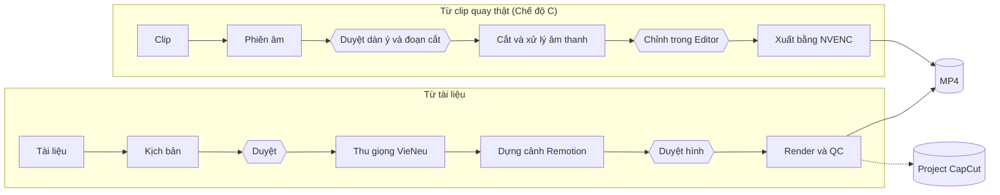

<div align="center">

# S6xEditer

**Biến tài liệu hoặc clip quay thật thành video đào tạo tiếng Việt, ngay trên máy của bạn.**

[](LICENSE)


[](https://www.remotion.dev)

[Bắt đầu nhanh](#bắt-đầu-nhanh) · [Hai luồng làm video](#hai-luồng-làm-video) · [Cổng kiểm tra](#cổng-kiểm-tra) · [Tài liệu](#tài-liệu) · [Giấy phép](#giấy-phép)

</div>

---

S6xEditer là pipeline dòng lệnh để làm video đào tạo, thiết kế để chạy cùng [Claude Code](https://claude.com/claude-code): AI viết kịch bản và dựng cảnh, còn bạn duyệt ở những điểm quan trọng. Máy móc chặn các lỗi đo được, như chữ không có trong tài liệu, hình trống hay âm lượng sai, trước khi video được xuất.

## Tính năng

- **Kể bằng hình theo từng câu:** mỗi câu trong kịch bản phải có mô tả hình, cảnh dựng bằng code nên render lại vẫn ra đúng hình đó.
- **Giọng đọc tiếng Việt chạy cục bộ:** dùng VieNeu-TTS, không cần gọi dịch vụ giọng đọc trả phí.
- **Dựng từ clip quay thật:** phiên âm, cắt, khử ồn, thêm phụ đề và lớp đồ hoạ.
- **Editor trên trình duyệt:** timeline nhiều track để tự chỉnh trước khi xuất.
- **Xuất nhiều dạng:** MP4 ở các khổ 16:9, 9:16, 4:5, 1:1, hoặc project CapCut nhiều lớp.
- **Có điểm duyệt của người dùng:** kịch bản và hình phải được duyệt thì mới đi tiếp; sửa kịch bản sau khi duyệt thì phiếu duyệt mất hiệu lực.
- **Không kèm nhạc:** bạn tự thêm nhạc mình có quyền dùng. Bộ 150+ hiệu ứng âm thanh trong repo do dự án tự sinh bằng code.

## Hai luồng làm video



| | Từ tài liệu | Chế độ C |
| :--- | :--- | :--- |
| **Đầu vào** | Tài liệu văn bản | Clip quay người nói |
| **Giọng** | VieNeu-TTS | Âm thanh gốc đã xử lý |
| **Dựng hình** | Remotion | Editor và HyperFrames |
| **Phần cứng** | NVIDIA, hoặc CPU nhưng chậm hơn nhiều | Cần NVIDIA |
| **Hướng dẫn** | [QUY-TRINH.md](docs/QUY-TRINH.md) | [CHE-DO-C.md](docs/CHE-DO-C.md) |

## Bắt đầu nhanh

### Cần có

| | Tối thiểu |
| :--- | :--- |
| Hệ điều hành | Windows 10 hoặc 11 |
| Node.js | 22 trở lên |
| GPU | NVIDIA, driver 550 trở lên (khuyến nghị) |
| Ổ đĩa trống | 30 GB, thêm 25 GB nếu cài Chế độ C |

### Cài đặt

```powershell
git clone https://github.com/chusaubanh/S6xEditer.git
cd S6xEditer
npm run setup
npm run doctor
```

`npm run setup` tự cài FFmpeg và uv qua winget nếu máy chưa có, rồi cài thư viện Node và môi trường giọng đọc. Model giọng đọc tự tải ở lần dùng đầu. `npm run doctor` cho biết máy đã sẵn sàng chưa.

Chế độ C cài thêm bằng `npm run th:setup`.

### Làm video đầu tiên

Repo có sẵn một kịch bản mẫu về cách pha trà. Mở một cửa sổ PowerShell và bật máy chủ giọng đọc:

```powershell
npm run tts:server
```

Rồi chạy ở cửa sổ khác:

```powershell
mkdir "output\Pha-tra"; copy "samples\Pha-tra\script.json" "output\Pha-tra\"

npm run script:validate -- "Pha-tra"
npm run approve -- "Pha-tra" script --by "tên bạn"
npm run voice -- "Pha-tra"
npm run stills -- "Pha-tra"
npm run approve -- "Pha-tra" visual --by "tên bạn"
npm run render -- "Pha-tra"
```

Video nằm ở `output/Pha-tra/video.mp4`.

## Cổng kiểm tra

| Cổng | Chặn |
| :--- | :--- |
| `script:validate` | Lời sáo, nhãn quá dài, từ và số không có trong tài liệu, video quá dài mà chưa tách |
| `voice`, `render` | Kịch bản hoặc hình chưa được người dùng duyệt |
| `gate:determinism` | Render lại ra hình khác, hoặc mọi khung giống hệt nhau |
| `stills` | Cảnh quá trống, nội dung sát mép khung |
| `render` | Sai khổ, fps, codec, thời lượng; độ to lệch quá 1 LU so với −14 LUFS; hình đứng yên quá lâu |

Máy không chấm được nội dung có đúng nghĩa so với tài liệu hay không, và hình có kể được ý của câu hay không. Hai việc đó vẫn cần người xem. Danh sách đầy đủ ở [QUY-TRINH.md](docs/QUY-TRINH.md#máy-móc-chặn-những-gì).

## Cấu trúc thư mục

```text
assets/            Thương hiệu, SFX, font, preset
input/             Tài liệu nguồn và clip quay
output/            Kịch bản, ảnh duyệt, video của từng dự án (không vào git)
samples/           Kịch bản mẫu
src/training/      Hợp đồng kịch bản, kiểm kịch bản, phiếu duyệt
src/audio/         Thu giọng và đo mốc giờ
src/remotion/      Bàn dựng chính
src/kit/           Bộ dựng: nhịp câu, nhãn, chuyển động, vật lý
src/videos/        Cảnh riêng của từng video
src/gates/         Các phép đo QC
src/talking-head/  Chế độ C
scripts/editor/    Editor trên trình duyệt
```

## Tuỳ biến thương hiệu

Thay logo trong `assets/brand/` và `public/brand/`, rồi sửa tên, màu và cách đọc từ trong `assets/brand/brand-guideline.json`.

## Phát triển

```powershell
npm run typecheck
npm test
npm run gate:determinism -- --fixtures
```

## Giới hạn hiện tại

- Chỉ hỗ trợ Windows.
- Đường chạy CPU mới được thử bằng cách ép CPU trên máy có NVIDIA, chưa thử trên máy thật không có NVIDIA.
- Cài Chế độ C từ đầu trên máy mới, gồm việc tự tải model, chưa được kiểm thử.
- Luồng quay màn hình và gói Premiere trong `scripts/screencast/` chưa được kiểm thử đầu cuối, và có thể cần sửa.

## Tài liệu

| Cần | Tài liệu |
| :--- | :--- |
| Các bước làm một video | [docs/QUY-TRINH.md](docs/QUY-TRINH.md) |
| Dựng từ clip quay thật | [docs/CHE-DO-C.md](docs/CHE-DO-C.md) |
| Quy chuẩn kịch bản | [docs/QUY-CHUAN-KICH-BAN.md](docs/QUY-CHUAN-KICH-BAN.md) |
| Quy chuẩn hình | [docs/QUY-CHUAN-HINH.md](docs/QUY-CHUAN-HINH.md) |

## Giấy phép

Mã của dự án phát hành theo [giấy phép MIT](LICENSE). Các thành phần bên thứ ba giữ giấy phép riêng, xem [THIRD-PARTY-NOTICES.md](THIRD-PARTY-NOTICES.md).

> [!IMPORTANT]
> **Remotion không miễn phí cho mọi trường hợp.** Đơn vị vì lợi nhuận có trên 3 nhân viên phải mua Company License. Hãy tự kiểm tra tại [remotion.dev/license](https://www.remotion.dev/license) trước khi dùng cho công việc.
